  

  
  
  

  
  
  
  
  

---

### 👋 About

- 3rd-year Electrical & Computer Engineering student at **RUET**.
- I build LLM systems end to end: agent harnesses, vision extraction pipelines and MCP tools. Each one ships with tests and a live URL.
- 🏆 Won **Build with AI, Hackdays @ RUET 2026** with qDNA. Led a startup team funded as **1 of 5 out of 130+ applicants**.
- 🎯 Looking for a **remote AI Engineer internship**.

### 🧠 AI systems

<table>
  <tr>
    <td width="50%" valign="top">
      
      Drives Claude Code or Codex in a locked-down Docker sandbox. Rejects tests that already pass on the broken code.
    </td>
    <td width="50%" valign="top">
      
      🏆 <b>Winner, Hackdays @ RUET 2026</b> · <a href="https://minihackathon-kappa.vercel.app">Live demo</a>
    </td>
  </tr>
  <tr>
    <td width="50%" valign="top">
      
      Gemma 4 vision grading · <a href="https://stepcheck.vercel.app">Live demo</a>
    </td>
    <td width="50%" valign="top">
      
      Custom MCP server over SQLite · 400 property-based test cases
    </td>
  </tr>
</table>

### 🚀 Shipped products

| Project | What it does | Stack |
|---|---|---|
| **[Dhaka Tesla Pool](https://github.com/adib-11/dhaka-tesla-pool)** · [live](https://dhaka-tesla-pool-ebon.vercel.app) | Ride pooling for Dhaka three-wheelers. Seat booking is concurrency-safe (no overbooking when two passengers accept at once), with a fare ledger and a full audit timeline. | TypeScript · Node.js · Docker |
| **[Business Model Canvas](https://www.thebusinessmodelcanvas.com/)** | Account-free canvas builder with real editable Word, PowerPoint, PDF and PNG exports. 100/100 Lighthouse. Organic search traffic from 28 countries in 7 languages within two weeks of launch. | Astro · TypeScript |
| **[ruetcs.org](https://ruetcs.org)** | Official RUET Computing Society website. 100/100 Lighthouse, admin and moderator dashboards, Turnstile-protected forms. | Next.js 15 · Supabase · Tailwind v4 |
| **[Portfolio](https://github.com/adib-11/Portfolio)** · [live](https://adibhasan.dev)   🥈 *1st Runner-Up, RCS Portfolio Hackathon 2026* | Animated developer portfolio. | React · TypeScript · GSAP |

### 🛠️ Tech stack

  
  
  
  
  
  
  

  

### 📊 GitHub stats

  
  

<picture>
  <source media="(prefers-color-scheme: dark)" srcset="./profile/snake-dark.svg" />
  
</picture>

### 🏆 Recognition

| | |
|---|---|
| 🏆 **Winner** | Build with AI, Hackdays @ RUET 2026, with [qDNA](https://github.com/adib-11/qdna) |
| 🥈 **1st Runner-Up** | RCS Portfolio Hackathon, RUET Computing Society 2026 |
| 🥉 **2nd Runner-Up** | Hult Prize at RUET 2026 |
| 💰 **Funded team lead** | UIHP Innovation Cohort 5: 1 of 5 teams funded out of 130+ (40,000 BDT pre-seed) |
| 🎖️ **13th** | SciBlitz 2.0 National Hackathon, IEEE CUET 2026, with [InfluenceIQ](https://github.com/adib-11/InfluenceIQ) |
| 🎖️ **Top 100** | Infinity AI Buildfest 2026, with [InfluenceIQ](https://github.com/adib-11/InfluenceIQ) |
| 🎖️ **Top 50** | SOLVIO AI Hackathon, Sheba Platform |

### 📜 Certifications

- **Associate AI Engineer for Developers**, DataCamp (Aug 2026): OpenAI API, embeddings, RAG, LangChain, MCP, LLMOps
- **Agentic AI**, DeepLearning.AI

